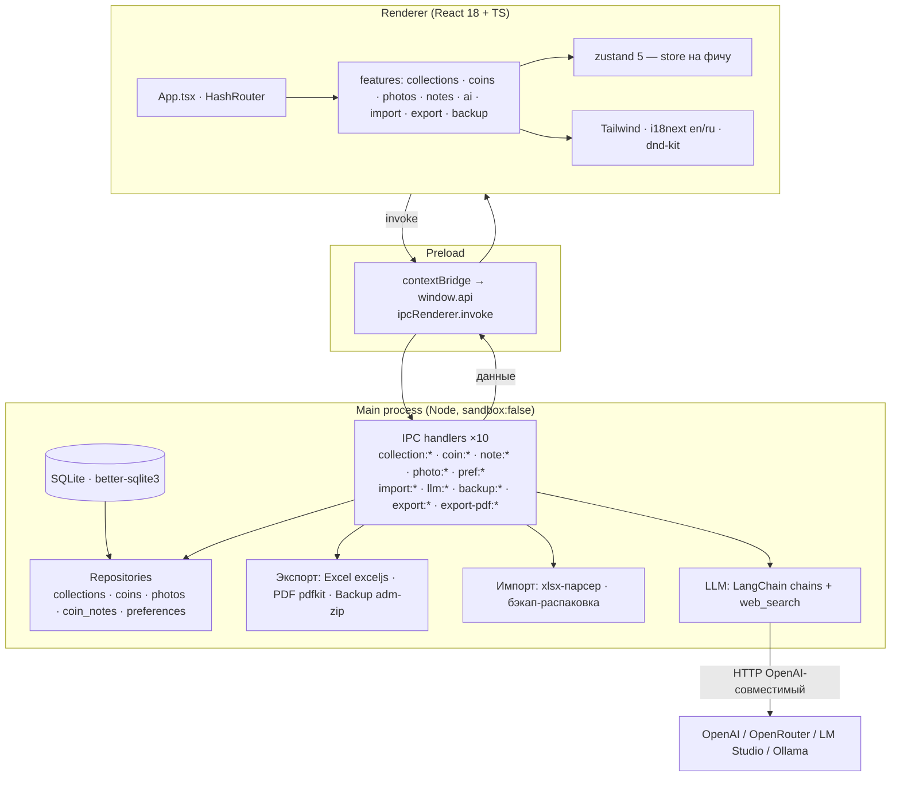
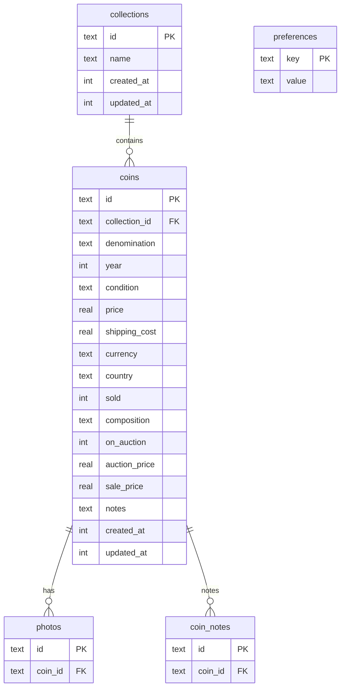

# Архитектура Coin Collection (v1.6.1)

Десктоп-приложение для коллекционеров монет: **Electron 33 + React 18 + TypeScript + SQLite**.
Сборка — `electron-vite`; нативные зависимости — `better-sqlite3`, `sharp` (пересобираются под Electron через `electron-rebuild`).

## 1. Процессная модель (Electron)

- **main** — владеет БД, IPC, логикой экспорта/импорта и LLM-цепочками;
- **preload** — единственный мост: `window.api` (коллекции, монеты, заметки, фото, настройки, импорт, экспорт, бэкап, LLM);
- **renderer** — React-UI, общается с main **только** через `window.api` (в тестах мокается).

## 2. Модель данных (SQLite, миграции V1–V8)

Важные нюансы эволюции схемы (из `src/main/database/migrations.ts`):
- **V1**: таблицы `countries`, `coins(country_id)`, `photos(coin_id)`, `preferences`, `coin_notes`, `_migrations`;
- **V4**: `countries` → переименована в **`collections`**, `country_id` → **`collection_id`** (т.е. коллекции изначально были «странами»; индекс `idx_coins_collection(collection_id, denomination, year, id)` навешивается здесь);
- **V6+**: расширение монет — `sold`, `composition`, `on_auction`, `auction_price`, `sale_price`.

## 3. LLM-подсистема (`src/main/llm/`)

- **Абстракция**: `@langchain/openai` — ChatOpenAI-совместимые провайдеры: OpenAI, OpenRouter (builtin `web_search`), LM Studio, Ollama (для локальных моделей увеличенный таймаут 180 с, `maxRetries 0`);
- **Конфиг**: сохраняется в `preferences` (`llm.provider/model/baseUrl/apiKey`, `llm.webSearch`, search-настройки), стартовая загрузка — `dotenv`;
- **Возможности**: заметки по монете (`llm/notes.ts`), агентная цепочка (`llm/chains.ts`), веб-поиск с провайдерами (`llm/search.ts`), bulk-сессии («resume»), валидация выходных схем через **zod** (`llm/schemas.ts`).

## 4. Импорт / экспорт / бэкап

| Канал | Библиотека | Что делает |
|---|---|---|
| Экспорт Excel | `exceljs` | выгрузка коллекции в .xlsx (с локализацией `l10n.ts`) |
| Экспорт PDF | `pdfkit` + встроенные шрифты DejaVu | отчёт по коллекции/монете |
| Бэкап | `adm-zip` | zip-архив с данными (экспорт/импорт `backup.ts`) |
| Импорт таблиц | `xlsx` + свой парсер | разбор xlsx → монеты, маппинг коллекций, выкачка фото |
| Фото | `sharp` | обработка/оптимизация, файлы копируются в `userData/photos/` |

## 5. Тестирование

- **vitest**: unit-тесты (`tests/features`, `tests/integration`, `tests/manual`) + coverage (отчёт в `coverage/` — покрыты main: database/export/import/ipc/llm и renderer: components/features);
- renderer-тесты мокают `window.api`.

## 6. Инфраструктура / прочее

- `.opencode/` — проект разрабатывался через opencode (скилл `github-release`);
- `.codegraph/` — SQLite-граф кода (для навигации);
- `.docs/` — plan.md, feature-notes, llm-integration, web-search;
- сборка дистрибутивов: `electron-builder` (mac/win), `out/` — результат билда.